---
title: Component Selection
---

# Component Selection – GripRx Motor Board

**Course:** EGR 304 – Embedded Systems Design  
**Team:** 103 – GripRx  
**Project:** Motor Board

## Overview

The purpose of this assignment is to evaluate and compare major electronic components for the GripRx Motor Board. The board uses a PIC18F57Q43 microcontroller to control a DC gear motor through an H-bridge motor driver.

The selection process considers electrical compatibility, performance, cost, power requirements, and ease of integration.

The major components evaluated are:

1. DC Gear Motor
2. H-Bridge Motor Driver
3. 5V Voltage Regulator
4. DC Power Supply

## 1. DC Gear Motor Selection

*Table 1: DC Gear Motor Comparison*

| Solution | Pros | Cons |
|---|---|---|
| 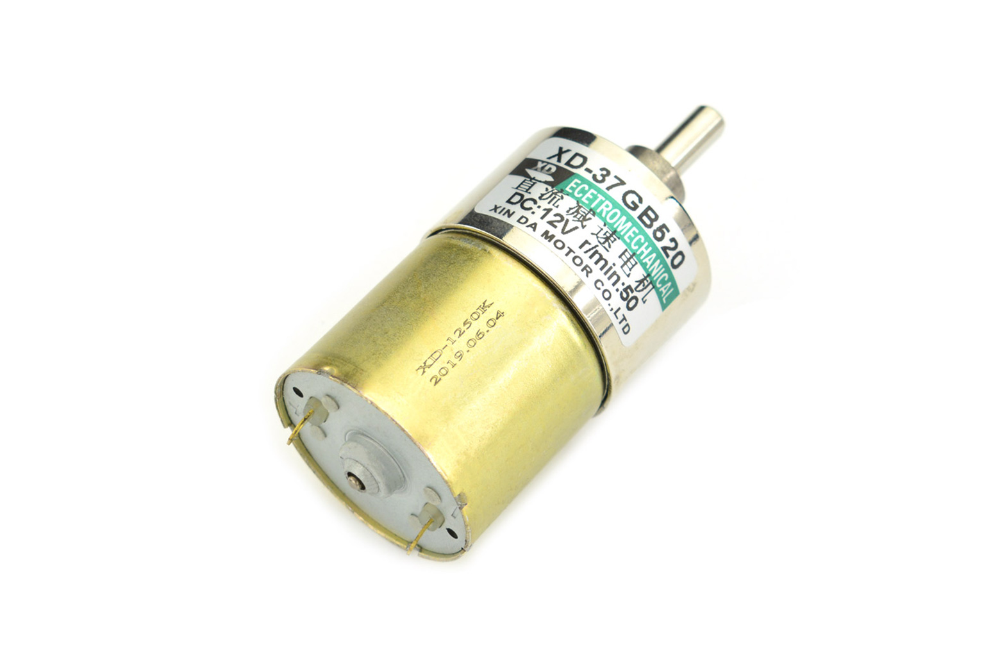  **Option 1: DFRobot FIT0492-A**   **Price:** $11.90 each   **Voltage:** 12V   **Speed:** 50 RPM no-load   **Rated torque:** 9 kg-cm   **Rated current:** 0.68A   **Stall current:** 2.19A   [Product Link](https://www.dfrobot.com/product-1471.html) | - Lowest price among the compared motors   - High rated torque for a geared motor   - Low rotational speed suitable for controlled gripping   - Metal gearbox for mechanical durability | - Requires a 12V supply for rated performance   - Stall current exceeds the 1A current-limit target in the current block diagram   - Relatively heavy at 210g   - No integrated position encoder |
| 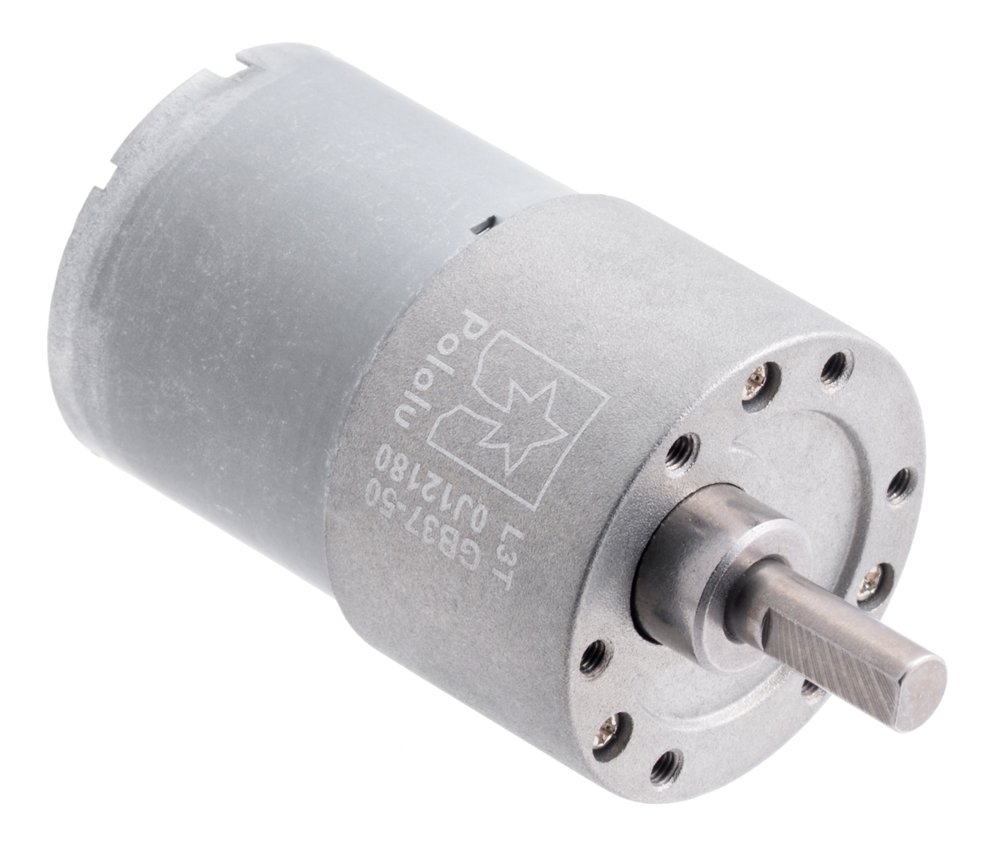  **Option 2: Pololu 50:1 37D**   **Price:** $38.95 each   **Voltage:** 12V   **Speed:** 200 RPM no-load   **Stall torque:** 21 kg-cm (extrapolated)   **Stall current:** 5.5A   [Product Link](https://www.pololu.com/product/4743) | - Durable metal gearbox   - Higher speed for faster movement   - Optional encoder-equipped version   - Detailed manufacturer specifications | - More expensive than Option 1   - High stall current requires careful driver and power-supply selection   - Higher speed may require additional control for precise gripping   - Extrapolated stall torque is not a recommended continuous operating torque |
| 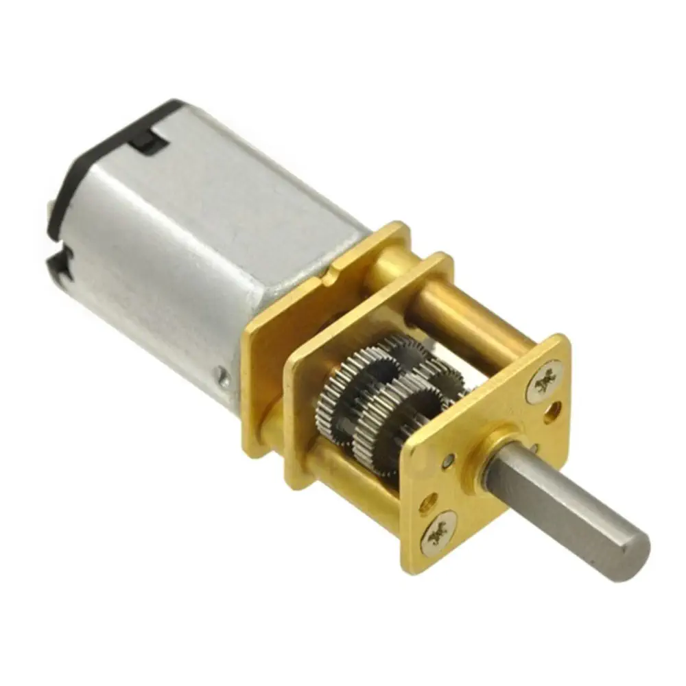  **Option 3: Pololu 150:1 Micro**   **Listed price:** $26.45 each   **Voltage:** 12V   **Speed:** 200 RPM no-load   **Stall torque:** approximately 2.9 kg-cm   **Stall current:** 0.8A   [Product Link](https://www.robotshop.com/products/12v-pololu-1501-micro-metal-gearmotor) | - Compact and lightweight design   - Lower stall current than the other two motors   - Metal gearbox   - Easier to accommodate in a small mechanism | - Much lower stall torque than the other options   - May not provide enough force for the gripping mechanism   - Higher no-load speed than Option 1   - More expensive than Option 1 |

**Preliminary Choice:** Option 1 – DFRobot FIT0492-A Metal DC Gear Motor.

**Rationale:** The DFRobot FIT0492-A is the preferred preliminary choice because it provides a useful combination of low output speed, substantial rated torque, and low cost. Its rated torque of 9 kg-cm and rated current of 0.68A make it a promising candidate for the GripRx gripping mechanism. The 50 RPM no-load speed may also help provide controlled opening and closing movement. Compared with the Pololu alternatives, it offers an attractive balance between torque and cost.
However, the motor is rated for 12V, while the current block diagram specifies a 9V power supply. The power supply selection should therefore be reconsidered. Additionally, the motor has a stall current of 2.19A, which exceeds the currently proposed 1A motor-driver current limit. The team must evaluate the motor driver's current-limit setting and confirm that the motor can produce sufficient gripping force without overheating or stalling.
The final motor selection will be confirmed after the mechanical design is completed and the required gripping torque is calculated or measured.

**Sources:**
- [DFRobot FIT0492-A Manufacturer Specifications](https://www.dfrobot.com/product-1471.html)
- [Pololu 50:1 Metal Gearmotor Specifications](https://www.pololu.com/product/4743)
- [Pololu 150:1 Micro Metal Gearmotor Listing](https://www.robotshop.com/products/12v-pololu-1501-micro-metal-gearmotor)

## 2. H-Bridge Motor Driver Selection

*Table 2: H-Bridge Motor Driver Comparison*

The GripRx Motor Board requires an H-bridge driver to control the direction and speed of a brushed DC gear motor. The driver must support PWM control, operate with the motor supply voltage, and provide adequate current handling and protection against motor startup and stall conditions.

| Solution | Pros | Cons |
|---|---|---|
| 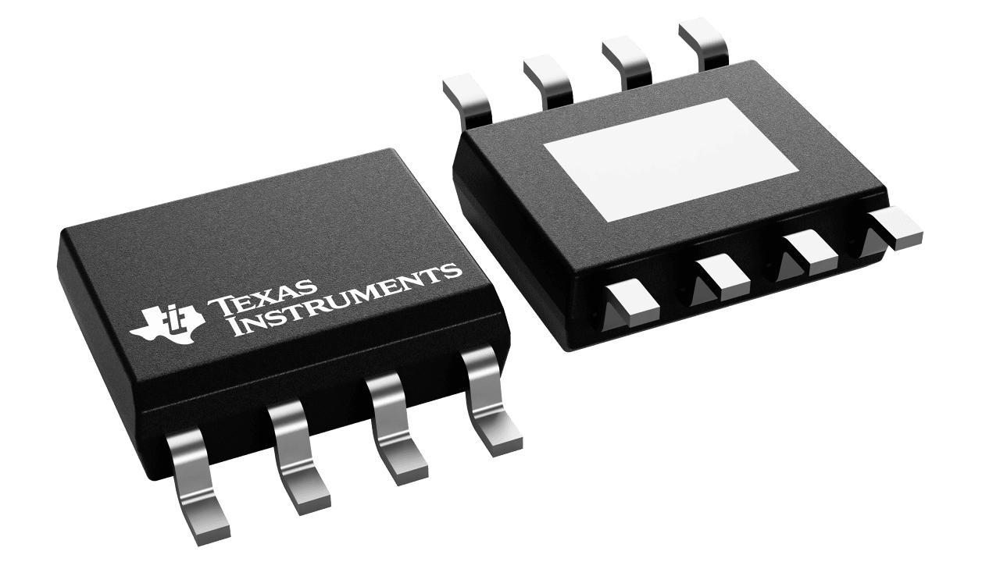  **Option 1: Texas Instruments DRV8871DDAR**   **Approximate price:** $2.90 each   **Supply voltage:** 6.5–45V   **Peak output current:** 3.6A   **Package:** 8-pin HSOP   [Product Link](https://www.ti.com/product/DRV8871) | - Supports bidirectional brushed DC motor control   - Supports PWM speed control   - Adjustable current regulation using an external resistor   - Integrated overcurrent and thermal protection   - Relatively simple two-input interface | - Current limit must be configured correctly   - Thermal design limits continuous current   - Does not provide the same current feedback capabilities as Option 3   - Current block diagram may need changes to the current-limit setting |
| 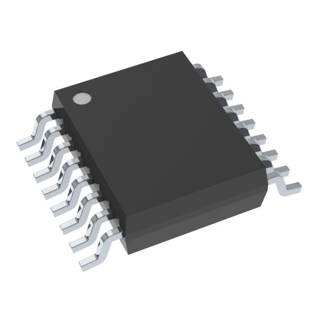  **Option 2: Texas Instruments DRV8876PWPR**   **Approximate price:** $1.95 each   **Supply voltage:** 4.5–37V   **Peak output current:** 3.5A   **Package:** 16-pin HTSSOP   [Product Link](https://www.ti.com/product/DRV8876) | - Lowest estimated unit price   - Integrated current sensing and regulation   - Supports PWM motor control   - Compatible with 3.3V and 5V logic   - Integrated fault protection | - More pins and control configurations   - Requires careful PCB layout and thermal design   - Additional configuration may increase circuit complexity   - Not a direct pin-compatible replacement for the DRV8871 |
| 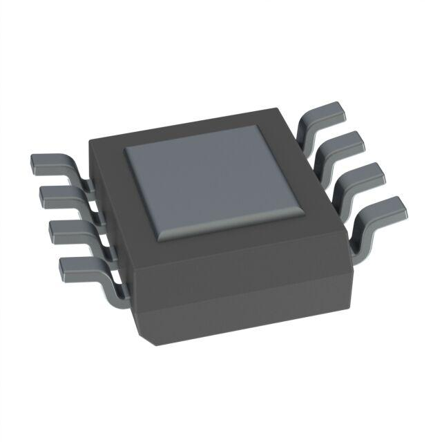  **Option 3: Texas Instruments DRV8251ADDAR**   **Approximate price:** $2.40 each   **Minimum supply voltage:** 4.5V   **Absolute maximum supply voltage:** 50V   **Peak output current:** 4.1A   **Package:** 8-pin HSOP   [Product Link](https://www.ti.com/product/DRV8251A) | - Highest specified peak current among the options   - Integrated current sensing and regulation   - Current feedback may support stall detection   - Supports common microcontroller logic levels   - Integrated thermal and overcurrent protection   - Compact package | - Requires configuration of current regulation   - Thermal performance must be verified   - Motor current must remain within safe operating limits   - Requires verification of the control interface |

**Preliminary Choice:** Option 3 – Texas Instruments DRV8251ADDAR.

**Rationale:** The DRV8251A is the preferred preliminary motor driver because it provides integrated current sensing, adjustable current regulation, and a peak output current rating of 4.1A. Its operating voltage range accommodates the proposed motor supply.

Current regulation is particularly useful for the GripRx project because the motor may experience increased mechanical resistance while gripping an object. The integrated current sensing feature may also help detect motor loading or stall conditions.

The DRV8871 remains a viable alternative and is already included in the team's preliminary block diagram. However, the DRV8251A offers additional current feedback functionality that may be beneficial during development.

The final selection depends on the required gripping torque, expected motor current, thermal performance, and implementation of the motor control signals. The proposed 9V supply must also be reconsidered because the selected motor is rated for 12V. The block diagram and PCB design must be updated if the team changes from the DRV8871 to the DRV8251A.

**Sources:**
- [Texas Instruments DRV8871 Product Information](https://www.ti.com/product/DRV8871)
- [Texas Instruments DRV8876 Product Information](https://www.ti.com/product/DRV8876)
- [Texas Instruments DRV8251A Product Information](https://www.ti.com/product/DRV8251A)

## 3. Voltage Regulator Selection

*Table 3: 5V Voltage Regulator Comparison*

The GripRx Motor Board requires a regulated 5V power supply for its control and interface electronics. A voltage regulator is needed to convert the main DC power supply voltage into a stable 5V output. Three regulators were compared based on output voltage, current capacity, efficiency, thermal performance, cost, and circuit complexity.

| Solution | Pros | Cons |
|---|---|---|
| 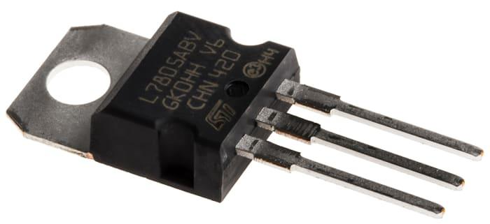  **Option 1: STMicroelectronics L7805ABV-DG**   **Example unit price:** $1.62   **Output voltage:** 5V   **Maximum rated output current:** 1.5A   **Maximum input voltage:** 35V   **Type:** Linear regulator   **Package:** TO-220-3   [Product Link](https://www.st.com/en/power-management/l78.html)   [Supplier Link](https://www.digikey.com/en/products/detail/stmicroelectronics/L7805ABV-DG/3945936) | - Simple circuit design   - Fixed 5V output   - Low switching noise because it is a linear regulator   - Integrated thermal and short-circuit protection   - Already included in the team's preliminary design   - Common TO-220 package | - Dissipates significant heat when input voltage is much higher than 5V   - May require a heatsink   - Lower efficiency than a switching regulator   - Output current capability is limited by thermal conditions |
| 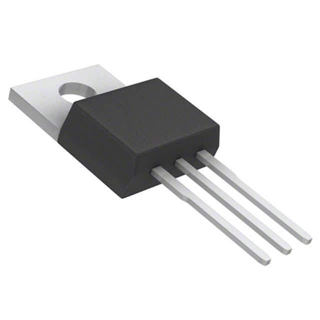  **Option 2: Texas Instruments LM7805CT/NOPB**   **Price:** $1.86   **Output voltage:** 5V   **Maximum rated output current:** 1.5A   **Type:** Linear regulator   **Package:** TO-220-3   [Product Link](https://www.ti.com/product/LM7800/part-details/LM7805CT/NOPB)   [Supplier Link](https://www.digikey.com/en/products/detail/texas-instruments/LM7805CT-NOPB/3901929) | - Simple fixed 5V regulation   - Integrated thermal and short-circuit protection   - Low switching noise   - Common three-terminal package   - Similar functionality to Option 1 | - Produces heat when stepping down from 9V or 12V   - May require additional cooling   - Lower efficiency than a buck regulator   - Offers limited advantages over the team's original selection |
| 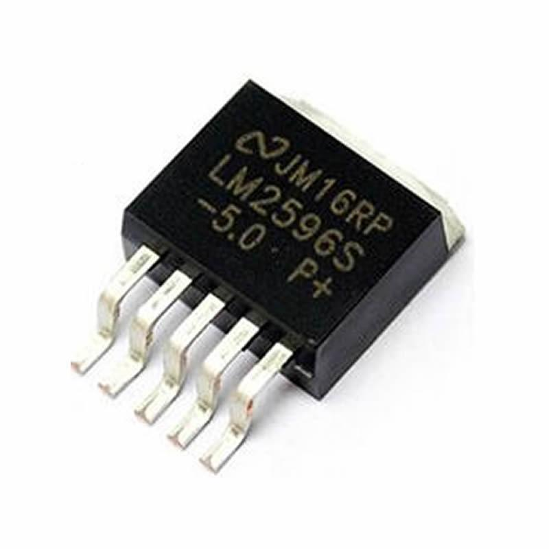  **Option 3: Texas Instruments LM2596S-5.0/NOPB**   **Example unit price:** $8.30   **Output voltage:** 5V   **Rated output current:** 3A   **Input voltage:** Up to 40V; check datasheet for required headroom   **Type:** Buck switching regulator   **Switching frequency:** 150kHz   **Package:** TO-263   [Product Link](https://www.ti.com/product/LM2596/part-details/LM2596S-5.0/NOPB)   [Supplier Link](https://www.digikey.com/en/products/detail/texas-instruments/LM2596S-5-0-NOPB/334842) | - More efficient than linear regulators for large voltage reductions   - Reduced power dissipation at moderate and high load currents   - Higher rated output current   - Integrated thermal and current-limit protection   - Suitable for generating 5V from a higher DC voltage | - Requires an external inductor, diode, and capacitors   - More complex PCB layout   - Produces switching noise   - Higher total circuit complexity and component count   - Must be laid out carefully to minimize electrical noise |

**Preliminary Choice:** Option 1 – STMicroelectronics L7805ABV-DG.

**Rationale:** The STMicroelectronics L7805ABV-DG is the preferred preliminary voltage regulator because it is already included in the team's design and provides a simple method of generating a regulated 5V supply. Its fixed output voltage, integrated protection features, and straightforward circuit requirements make it a practical choice for the GripRx Motor Board.

However, the regulator's thermal performance must be evaluated before final selection. Linear regulators dissipate power equal to the voltage difference between the input and output multiplied by the load current:

P = (Vin - Vout) x Iout

For example, with a 12V input, 5V output, and 0.5A load:

P = (12V - 5V) x 0.5A = 3.5W

This represents significant heat dissipation and may require a heatsink or an alternative regulator design.

The LM2596 switching regulator is a promising alternative because it can generate 5V more efficiently at higher current loads. However, it requires additional components and more careful PCB layout.

The final regulator choice will depend on the total current required by the 5V electronics, the finalized input supply voltage, the available PCB space, and the thermal requirements. The team must verify that the regulator can safely provide the necessary output current without overheating.

**Sources:**
- [STMicroelectronics L78 Product Information](https://www.st.com/en/power-management/l78.html)
- [STMicroelectronics L78 Datasheet](https://www.st.com/resource/en/datasheet/l78.pdf)
- [Texas Instruments LM7805 Product Information](https://www.ti.com/product/LM7800/part-details/LM7805CT/NOPB)
- [Texas Instruments LM2596 Product Information](https://www.ti.com/product/LM2596/part-details/LM2596S-5.0/NOPB)
- [L7805ABV-DG Supplier Listing](https://www.digikey.com/en/products/detail/stmicroelectronics/L7805ABV-DG/3945936)
- [LM7805CT/NOPB Supplier Listing](https://www.digikey.com/en/products/detail/texas-instruments/LM7805CT-NOPB/3901929)
- [LM2596S-5.0/NOPB Supplier Listing](https://www.digikey.com/en/products/detail/texas-instruments/LM2596S-5-0-NOPB/334842)

## 4. Power Supply Selection

*Table 4: DC Power Supply Comparison*

The GripRx Motor Board requires a DC power supply capable of powering the motor driver, DC gear motor, and 5V regulation circuitry. The selected DFRobot FIT0492-A motor is rated for 12V, while the team's original power supply proposal was a 9V, 3A adapter. Three power supply options were compared based on voltage compatibility, current capacity, power rating, cost, and ease of integration.

| Solution | Pros | Cons |
|---|---|---|
| 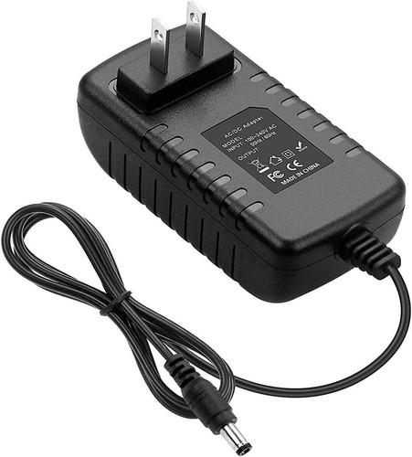  **Option 1: 9V 3A Universal DC Power Adapter – Newegg**   **Listed price:** $34.18 (verify current price)   **Output voltage:** 9V DC   **Maximum output current:** 3A   **Maximum output power:** 27W   **Type:** AC/DC wall adapter   **Connector:** Interchangeable barrel tips; verify dimensions and polarity   [Product Link](https://www.newegg.com/p/16J-02GJ-003H4) | - Matches the team's originally proposed 9V and 3A supply specifications   - Provides a nominal 27W output capacity   - External adapter avoids placing AC mains circuitry on the PCB   - Interchangeable tips provide flexibility when connecting different devices | - Output voltage is below the motor's rated 12V   - Motor may operate at reduced speed and torque   - Exact connector dimensions and polarity must be verified   - Higher listed cost than the other compared supplies   - Manufacturer datasheet has not been confirmed |
| 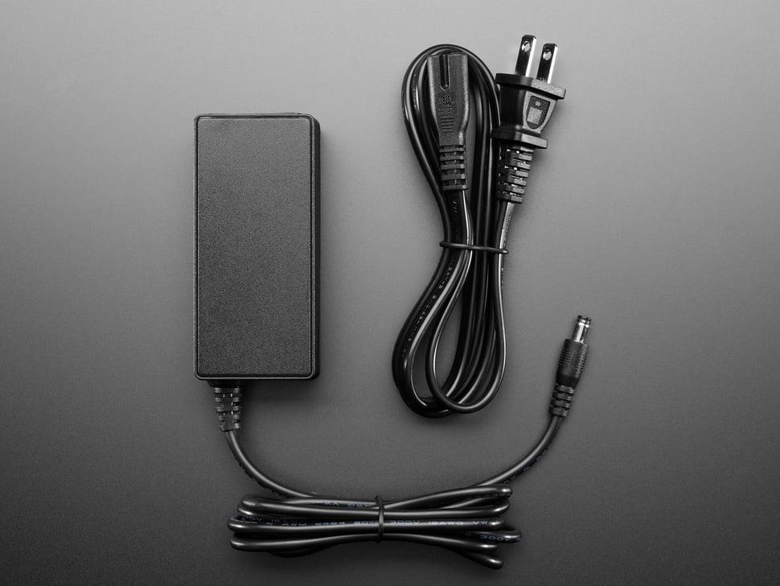  **Option 2: Adafruit 12V 5A Switching Power Supply**   **Listed price:** $24.95   **Output voltage:** 12V DC   **Maximum output current:** 5A   **Maximum output power:** 60W   **AC input:** 110–220V   **Connector:** 5.5mm outer / 2.1mm inner barrel plug   [Product Link](https://www.adafruit.com/product/352) | - Matches the motor's rated 12V supply   - Provides additional current capacity for motor startup and other circuitry   - Fixed output voltage avoids adjustment errors   - External switching supply   - Documented product specifications and connector dimensions | - Higher listed price   - Larger supply than may be necessary   - Connector and polarity must match the board   - Additional current capacity does not replace motor current limiting   - The 5V regulator must be checked for heat dissipation |
| 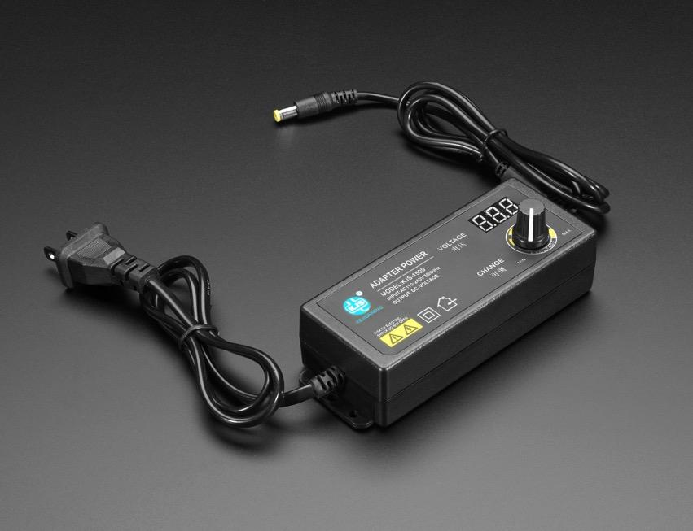  **Option 3: Adafruit Adjustable 3–12V 5A Power Supply**   **Listed price:** $17.50   **Output voltage:** Adjustable from 3V to 12V DC   **Maximum rated output current:** 5A   **Maximum rated output power at 12V:** 60W   **AC input:** 100–240V   **Connector:** 5.5mm / 2.1mm barrel plug   [Product Link](https://www.adafruit.com/product/4880) | - Can be adjusted to the motor's rated 12V   - Useful for testing at different motor supply voltages   - Provides additional current capacity   - Lower listed price than Option 2   - Suitable for laboratory development | - Adjustable voltage introduces risk of incorrect settings   - Voltage should be measured before connecting the board   - Less convenient than a fixed-voltage supply for a final product   - Connector and polarity must be checked   - Motor current regulation remains necessary |

**Preliminary Choice:** Option 2 – Adafruit 12V 5A Switching Power Supply.

**Rationale:** The Adafruit 12V 5A switching power supply is the preferred preliminary option because its regulated 12V output matches the rated voltage of the selected DFRobot FIT0492-A DC gear motor. Its maximum current rating of 5A also provides headroom above the motor's specified 2.19A stall current.

The team's originally proposed BestCH 9V 3A adapter could operate the motor below its rated voltage, but motor speed and available torque may be reduced. Since the GripRx mechanism requires reliable gripping force, a 12V supply is a more appropriate starting point.

The adjustable Adafruit supply is also a useful alternative, particularly for testing. However, a fixed 12V output is preferable for the final design because it reduces the possibility of incorrect voltage adjustment.

The maximum electrical output power can be estimated using:

P = V x I

For the original 9V 3A adapter:

P = 9V x 3A = 27W

For the proposed 12V 5A adapter:

P = 12V x 5A = 60W

These calculations represent the maximum rated supply outputs, not the actual power consumed by the GripRx Motor Board. The circuit draws current according to its load.

Before finalizing the power supply, the team must verify the total current requirement, DC connector dimensions, polarity, motor-driver current regulation, and the thermal performance of the 5V regulator. A higher-current power supply does not automatically protect the motor or driver from excessive current.

**Sources:**
- [9V 3A Power Adapter – Newegg](https://www.newegg.com/p/16J-02GJ-003H4)
- [Adafruit 12V 5A Switching Power Supply](https://www.adafruit.com/product/352)
- [Adafruit Adjustable 3–12V 5A Power Supply](https://www.adafruit.com/product/4880)
- [Adafruit Power Supply Guide](https://learn.adafruit.com/power-supplies)

## Final Component Selection Summary

After comparing three alternatives for each major component, the following components were identified as the preliminary selections for the GripRx Motor Board. The selections were based on electrical specifications, compatibility, cost, functionality, and suitability for the proposed gripping mechanism.

*Table 5: Final Component Selection Summary*

| Component | Preliminary Selection | Key Specifications | Reason for Selection |
|---|---|---|---|
| DC Gear Motor | **DFRobot FIT0492-A** | 12V DC; approximately 2.19A stall current | Provides geared motor operation suitable for the proposed gripping mechanism. Final suitability depends on the required gripping torque and speed. |
| H-Bridge Motor Driver | **Texas Instruments DRV8251ADDAR** | 4.5V minimum supply; 4.1A peak output current | Supports bidirectional motor control, PWM operation, and integrated current sensing and regulation. |
| 5V Voltage Regulator | **STMicroelectronics L7805ABV-DG** | Fixed 5V output; 1.5A rated output current | Provides a simple method of generating a regulated 5V supply and is already included in the team's preliminary design. |
| DC Power Supply | **Adafruit 12V 5A Switching Power Supply** | 12V DC; 5A maximum output current; 60W maximum output power | Matches the motor's rated voltage and provides current capacity for the motor and supporting electronics. |

### Overall Design Considerations

The selected components provide a preliminary electrical configuration for the GripRx Motor Board. The 12V power supply will provide power to the motor driver and motor, while the 5V voltage regulator will provide regulated power for the appropriate low-voltage electronics.

Several design considerations must be addressed before finalizing the selections:

- **Motor Requirements:** The required gripping torque and operating speed must be determined to verify that the DFRobot FIT0492-A is appropriate for the mechanism.

- **Motor Driver Compatibility:** The DRV8251ADDAR was selected as the preferred preliminary driver because of its current sensing and regulation capabilities. However, the team's original block diagram specifies the DRV8871DDAR. The team must approve any change and update the schematic, PCB design, and control connections accordingly.

- **Current Protection:** The motor has a specified stall current of approximately 2.19A. The motor driver's current regulation, thermal performance, and safe operating limits must be verified. The driver's peak current rating does not represent its guaranteed continuous current capability.

- **Voltage Regulation:** The L7805ABV-DG can generate the required 5V output, but its power dissipation must be evaluated. With a 12V input, a significant amount of heat may be generated depending on the load current. A switching regulator may be preferable if the 5V current requirement is high.

- **Power Supply Compatibility:** The proposed 12V 5A adapter provides a more appropriate voltage for the selected motor than the team's original 9V 3A adapter. The final design must verify total current requirements, connector dimensions, polarity, and electrical protection.

### Conclusion

The DFRobot FIT0492-A motor, Texas Instruments DRV8251ADDAR motor driver, STMicroelectronics L7805ABV-DG voltage regulator, and Adafruit 12V 5A power supply form the recommended preliminary component combination for the GripRx Motor Board.

These components were selected based on their expected electrical compatibility and functional advantages. However, the final selection remains subject to verification of gripping torque, motor current, thermal performance, power requirements, and team design approval.

The comparisons provide a starting point for completing the schematic, PCB layout, and subsequent testing of the GripRx Motor Board.
