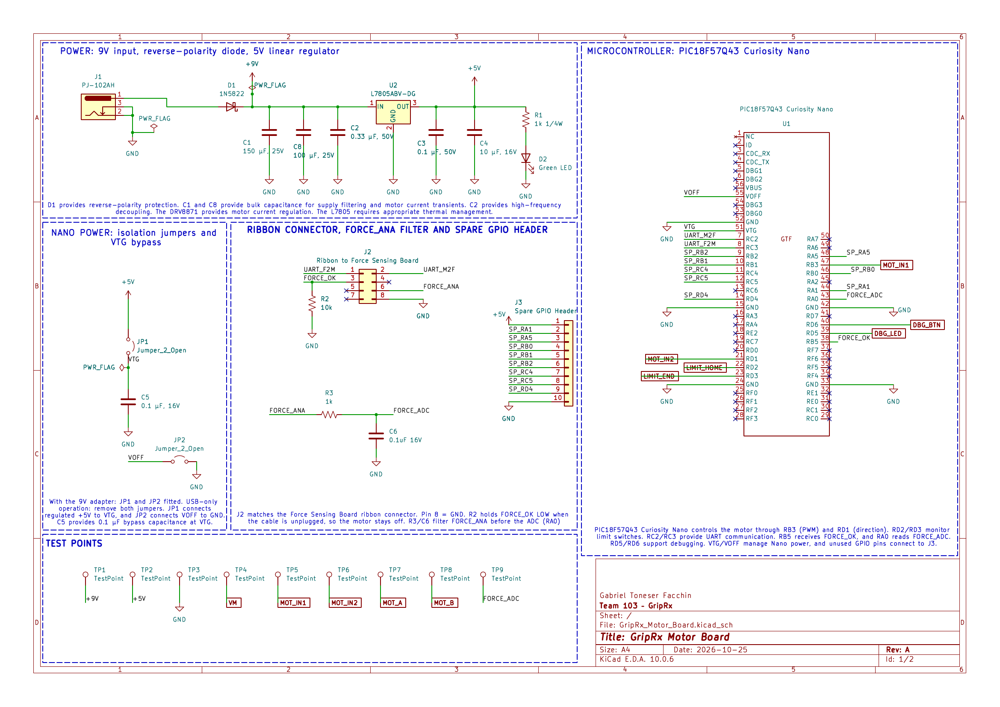
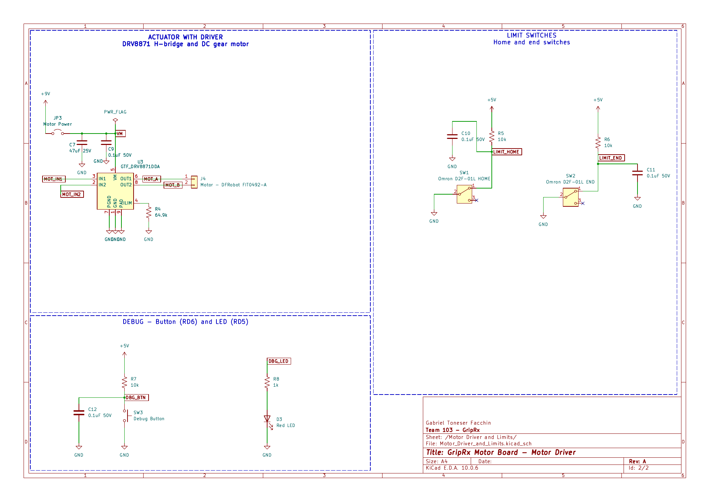

---
title: Schematic
---

## Overview

This schematic shows the **GripRx Motor Board**, designed for Team 103's GripRx project in EGR 304 Embedded Systems Design.

**Sheet 1** contains the 9 V power input with a 2 A slow-blow fuse, reverse-polarity protection diode, and L7805 5 V linear regulator. It also includes the PIC18F57Q43 Curiosity Nano microcontroller, Nano power isolation jumpers, an 8-pin ribbon connector to the Force Sensing Board, a spare GPIO header, and test points for power and control signals.

**Sheet 2** contains the DRV8871 H-bridge motor driver controlling the DFRobot FIT0492-A DC gear motor. It includes motor power filtering capacitors, a current-limit resistor, HOME and END limit switches with pull-up resistors and filtering capacitors, and a debug push button and LED.

The PIC18F57Q43 controls the motor using PWM and direction signals, monitors the limit switches, and communicates with the Force Sensing Board through UART and force-related signals.

The schematic was created in KiCad and passed the Electrical Rules Checker (ERC) with **0 errors and 0 warnings**.

## Schematic Drawings

**Figure 1.** Sheet 1: Power supply, microcontroller, ribbon connector, GPIO header, and test points.

**Figure 2.** Sheet 2: DRV8871 motor driver, DC gear motor, HOME and END limit switches, and debug circuitry.

## Resources

- [Schematic (PDF)](GripRx_Motor_Board.pdf)
- [KiCad Project (ZIP)](GripRx_Motor_Board_Project.zip)
