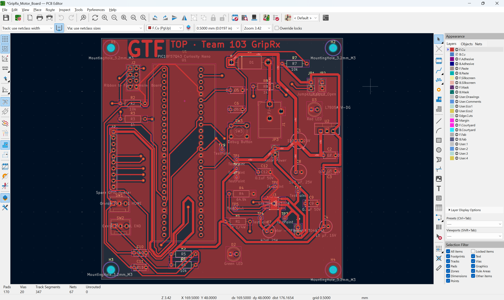
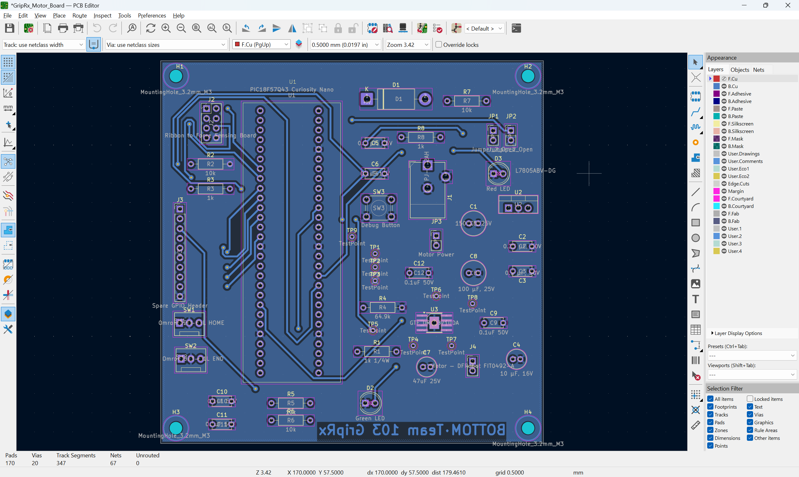

## PCB Layout

The GripRx Motor Board is a two-layer PCB designed in KiCad. The images below show the front and back copper layers, including component placement, traces, and mounting holes.

### Front PCB Layout

### Back PCB Layout

### PCB Layout PDF

The complete PCB layout is available as a downloadable PDF, including the front and back copper layers, silkscreen, and solder mask.

[Download GripRx PCB Layout PDF](GripRx_PCB_Layout.pdf)

## KiCad Project Files

Download the complete GripRx Motor Board KiCad project, including the PCB layout, schematics, and custom libraries.

[Download GripRx KiCad Project (ZIP)](GripRx_KiCad_Project_Final.zip)

## PCB Manufacturing Files

The Gerber and drill files for the GripRx Motor Board are available below.

[Download GripRx Motor Board Gerber Files (ZIP)](GripRx_Motor_Board_2_Gerbers.zip)

## Design Rules Check (DRC)

The GripRx Motor Board was verified using KiCad's Design Rules Checker.

- 0 DRC violations
- 0 unconnected pads
- 0 footprint errors

[Download DRC Confirmation Report (PDF)](GripRx_DRC_Confirmation.pdf)

## Design for Manufacturing (DFM) Analysis

The GripRx Motor Board Gerber files were analyzed using
JLCDFM to evaluate PCB manufacturability.

The report includes checks for copper traces, pad spacing,
solder mask, silkscreen, and drill holes.

[Download JLCDFM Analysis Report (PDF)](GripRx_DFM_Analysis_Report.pdf)
